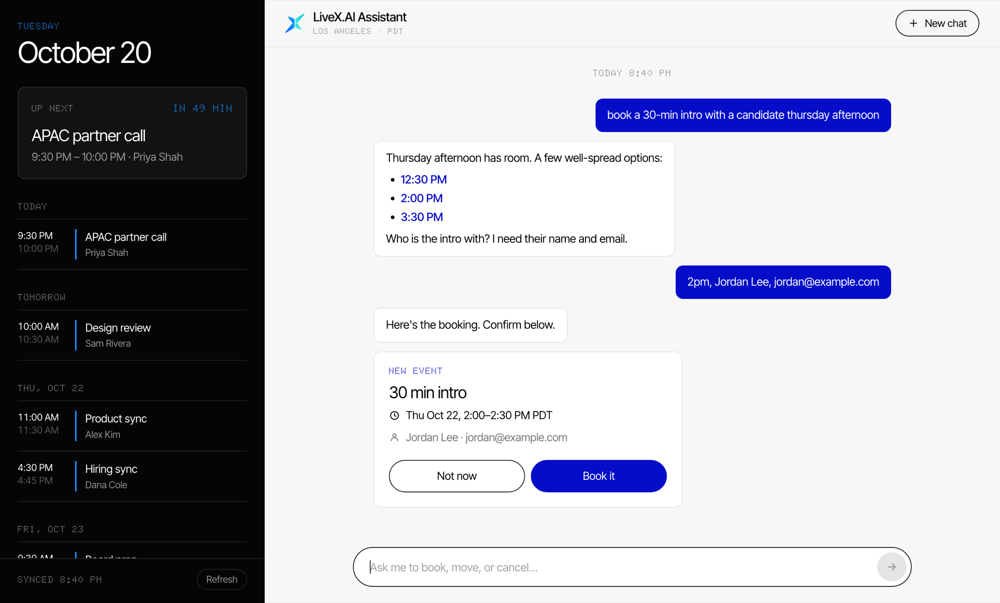

# LiveX.AI Assistant

A chat assistant that manages a cal.com calendar in plain language. It's built for a busy founder who would rather
type "book a 30-min intro with a candidate Thursday afternoon" than click through forms. It can book, list,
reschedule, update and cancel meetings.

**Live demo:** https://d8f0ss1s0decm.cloudfront.net (the access code is in my submission email)



## Features

- **Plain-language scheduling.** Understands "tomorrow", "Thursday afternoon" or "after 3pm" in your timezone. If a
  request is vague, it asks a short follow-up with tap-able answers.
- **Pick a time with one click.** Open times show as buttons instead of a wall of text.
- **Confirm before anything changes.** Every booking, move, update or cancel shows a card first.
- **Calendar views.** A sidebar shows your next meeting and the next two weeks, and there's a day, week and month
  calendar. Click a meeting to join, move or cancel it.
- **Works beyond this app.** The cal.com tools are a standalone MCP server that also plugs into Claude Desktop or
  Claude Code.

## Try it

| Type this | What happens |
|---|---|
| `what's on my calendar tomorrow?` | Lists tomorrow's meetings |
| `book a 30-min intro with a candidate Thursday afternoon` | Shows open Thursday times and asks who it's with |
| `move it to later that day` | Offers later times, then a reschedule card |
| `wrong email, it's jordan@lee.dev` | Shows an update card with the fix |
| `cancel that intro` | Shows a cancel card |

Bookings are real: they show up in cal.com, and the attendee gets cal.com's emails. So use an address that can
receive mail.

## How it works

```
Browser ──▶ CloudFront ──┬─ /*     ─▶ S3 (chat UI)
                         └─ /api/* ─▶ Lambda: FastAPI + Claude tool loop
                                        ├─ MCP ─▶ cal.com MCP server ─▶ cal.com API
                                        ├─ SSM Parameter Store: API keys, access code
                                        └─ DynamoDB: chat sessions
```

Claude decides which tools to call. The MCP server talks to cal.com, through 8 tools: 4 that read and 4 that make
changes.

The [dev plan](docs/dev-plan.md) has the full design, with diagrams of a chat turn, the confirmation gate, time
handling, the build plan and the test layers.

## Design decisions

- **The confirmation step is enforced in code, not the prompt.** When Claude calls a tool that changes the calendar,
  the app holds the call and shows a card. It only runs the call after the user confirms.
- **Safety checks live in the MCP server.** Before booking, the server checks again that the slot is still free. It
  also validates the email and rejects past times. Its error messages tell the model how to recover, so every client
  gets the same protection.
- **The model never does timezone math.** Tools take local dates and phrases like "afternoon", and Python converts
  them. The UI only shows times cal.com actually returned, so a made-up time can't reach the screen.
- **Working around cal.com's limits:**
  - The API can't set a meeting's title, so each meeting is booked on a hidden event type named after it.
  - The API can't change an attendee, so an update books an identical copy with the fix and then cancels the
    original.
- **Same code locally and on AWS.** Lambda Web Adapter runs the FastAPI app unchanged. Sessions in DynamoDB keep
  confirmations working across Lambda instances.

## Run it locally

You need Python 3.11+, a [cal.com](https://cal.com) API key (Settings → Security → API keys) and an
[Anthropic API key](https://console.anthropic.com).

```bash
make install
cp .env.example .env    # add CAL_API_KEY and ANTHROPIC_API_KEY
make run                # http://localhost:8000
make test               # 41 tests, no network or keys needed
```

To deploy your own copy, add `CAL_API_KEY`, `ANTHROPIC_API_KEY` and `ACCESS_PASSCODE` to SSM Parameter Store under
`/livex-assistant/`, then run `make deploy`. This needs the AWS CLI and SAM CLI.

## Tech stack

Python, FastAPI, Claude (Anthropic API), MCP, vanilla JS. On AWS: CloudFront, S3, Lambda, DynamoDB and SSM.

## What I'd do next

- **Stream replies** so text shows up as it's written, instead of after a few seconds.
- **Support multiple users,** each with their own sign-in and cal.com account.
- **Add evals:** scripted conversations run in CI, checking for no unconfirmed changes and no invented times.
