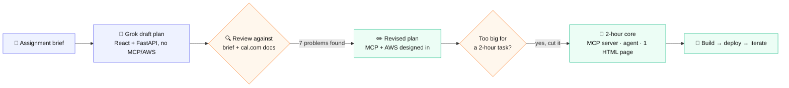
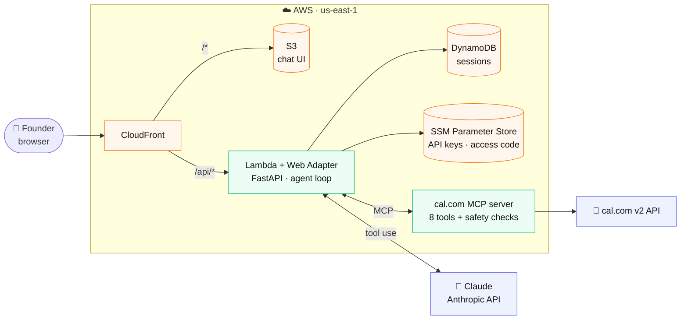
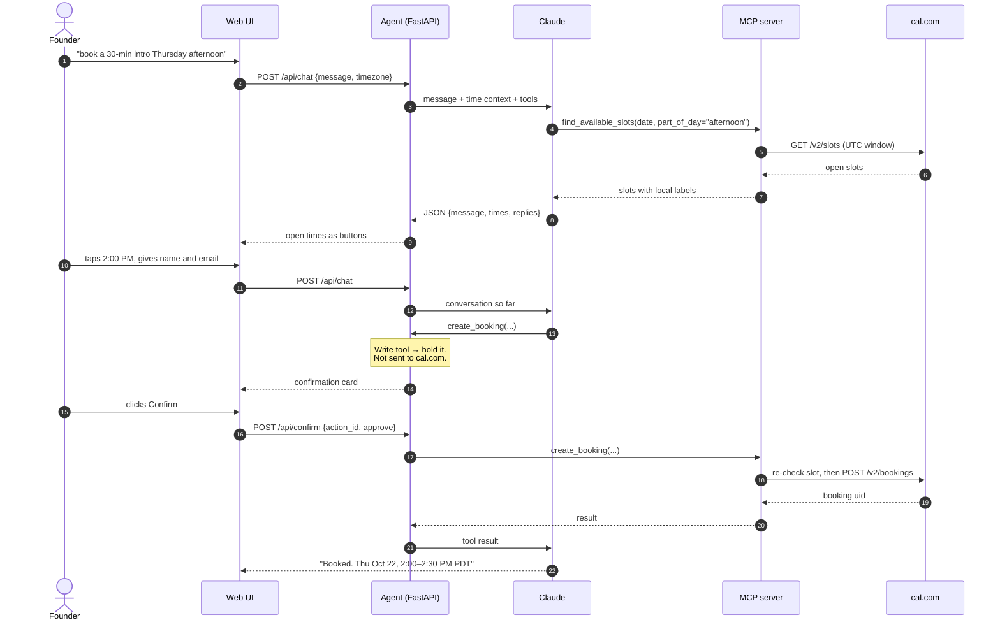
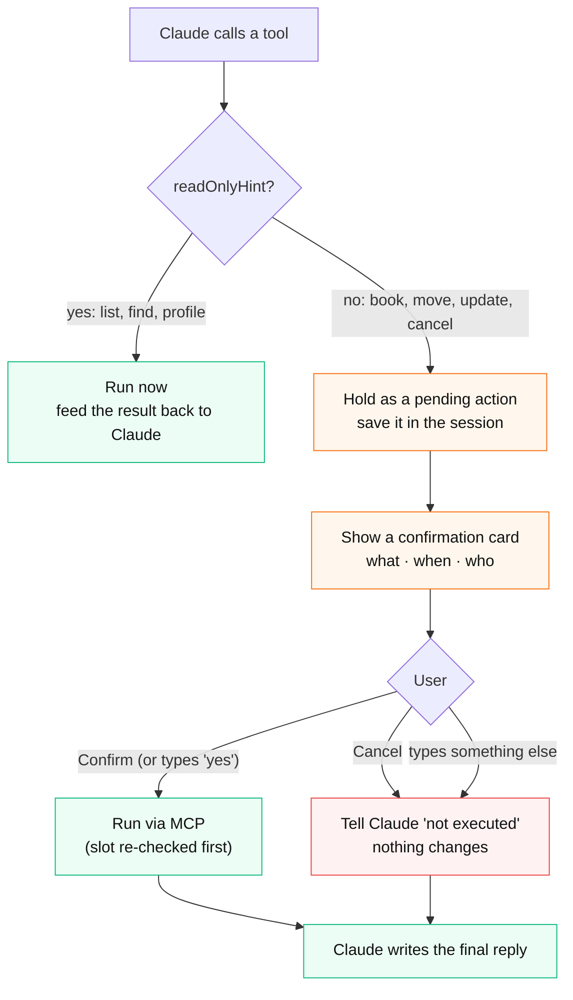
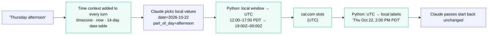
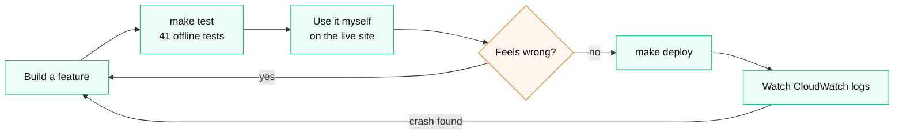
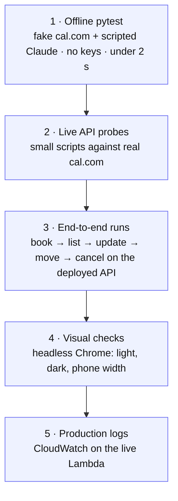
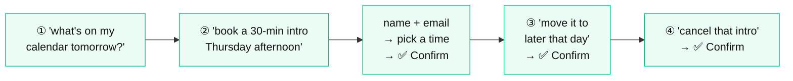

# Dev plan: LiveX.AI Assistant

> A Python chatbot that lets a busy founder manage cal.com in plain language: **book, list, cancel and reschedule**,
> in a web UI. This is the plan I built from. The [last section](#plan-vs-shipped) shows how it changed during the
> build.

| | |
|---|---|
| **Goal** | The four assignment prompts work in the browser like a sharp assistant would handle them: few questions, correct times, no made-up bookings |
| **Scope rule** | Get the core working end to end first. Add MCP and AWS only where they do real work in the product. List everything else as a next step |
| **Hard rule** | Nothing changes on the calendar until the user clicks **Confirm** |
| **Done when** | A reviewer clones the repo, adds two keys, runs one command, and the four demo chats work against a real cal.com account |

---

## 1. How the plan was made

I started from an AI-drafted plan. I checked it against the brief and the live cal.com API docs, fixed what was
wrong, and then cut it down to a 2-hour core.

**What the review fixed in the draft:**

| # | Problem in the draft | Fix in this plan |
|---|---|---|
| 1 | No MCP or AWS, the two skills I wanted to show | Make the cal.com tools an MCP server and host the app on AWS |
| 2 | One global `cal-api-version` | Pin the version per endpoint. A wrong version silently returns an older response shape |
| 3 | Rescheduling gives the booking a **new uid**, and the draft didn't track it | Track the new uid so "cancel that intro" still works after a move |
| 4 | "The model must confirm" was only a prompt rule | Enforce a real two-step confirmation in code |
| 5 | Date math was left to the LLM | Do all timezone math in Python. The model only sees local labels |
| 6 | Sessions in memory break on Lambda, which runs many instances | Swap in a session store (DynamoDB on AWS) |
| 7 | No tests | Test offline against a fake cal.com and a scripted LLM |

---

## 2. Architecture

| Piece | Choice | Why |
|---|---|---|
| Server | FastAPI, Python 3.11+, `httpx` | Async, small, and the same app runs locally and on Lambda |
| Tools | **MCP server** (official `mcp` SDK) wrapping cal.com v2 | Any MCP client (Claude Desktop, Claude Code) gets the same tools and checks |
| Agent | Claude tool-use loop (capped at 8 rounds) with an MCP client | Claude chooses the tools. Code decides what is allowed to run |
| LLM | `LLM_PROVIDER=anthropic` or `bedrock`, same code path | Bedrock was blocked on the new account, so it stays a one-line switch |
| UI | One `index.html` in vanilla JS, served by FastAPI | No build step, one port |
| State | Sessions in memory locally, DynamoDB on AWS | A Confirm click can land on any Lambda instance |
| Secrets | `.env` locally, SSM SecureString on AWS | Secrets never reach the browser or the repo |

---

## 3. One chat turn, end to end

Example: *"book a 30-min intro with a candidate Thursday afternoon"*.

---

## 4. The confirmation gate

The gate is enforced **in code, from the MCP tool annotations**, not by the prompt. A write can't reach cal.com
without a click.

---

## 5. Time handling: the LLM never does date math

"Thursday afternoon" is where scheduling bots usually go wrong, so Python handles every conversion.

`part_of_day` is mapped in code: morning 8–12, afternoon 12–17, evening 17–21. `zoneinfo` handles daylight saving
time, such as the switch from PDT to PST on Nov 1.

---

## 6. MCP tools

The plan called for 6 tools. The build shipped 8.

| Tool | Kind | Notes |
|---|---|---|
| `get_profile` | 🔍 read | Host name, email and timezone |
| `list_event_types` | 🔍 read | Chooses the event type and the allowed lengths and locations |
| `find_available_slots` | 🔍 read | Takes local dates plus `part_of_day` or `after_time`. Slots come back grouped by day with local labels |
| `list_bookings` | 🔍 read | A compact list: uid, title, local start and end, attendee |
| `create_booking` | ✏️ write | Re-checks that the slot is still free and validates the email |
| `reschedule_booking` | ✏️ write | Returns the **new** uid. A stale uid gets an error naming its replacement |
| `update_booking` | ✏️ write | Fixes the attendee name or email by booking a corrected copy, then cancelling the original |
| `cancel_booking` | ✏️ write | Checks that the uid exists and is still active |

Errors tell the model how to recover, for example *"That slot is no longer available. Call find_available_slots
again."*

### cal.com API, checked against the docs

| Call | HTTP | `cal-api-version` |
|---|---|---|
| Event types | `GET /v2/event-types` | `2024-06-14` |
| Slots | `GET /v2/slots` | `2024-09-04` |
| List bookings | `GET /v2/bookings` | `2026-05-01` |
| Create, reschedule, cancel | `POST /v2/bookings[/{uid}/reschedule\|cancel]` | `2026-02-25` |

**Gotchas found in the docs and in live testing:**

- Send times in UTC ISO 8601.
- Rescheduling returns a new uid. Pass `rescheduledBy=<host email>` so the move is confirmed automatically.
- Use `bookingUidToReschedule` on slot queries so the meeting's own time still shows as free.
- The slots API only returns slots that fit entirely inside the window, so the re-check before a write needs a wider
  window.
- cal.com rejects attendee emails at `@example.com`.
- The API can't set a booking's title. As a workaround, each named meeting is booked on a hidden event type that
  carries the name.

---

## 7. Build plan (2-hour core)

```mermaid
gantt
    title Planned 2-hour core
    dateFormat HH:mm
    axisFormat %H:%M
    section Setup
    Account, key, seed bookings :a1, 00:00, 15m
    section MCP server
    Client + MCP tools :a2, after a1, 30m
    section Agent
    Loop, time, confirm gate :a3, after a2, 30m
    section UI
    Chat page + cards :a4, after a3, 25m
    section Ship
    Demo run + README :a5, after a4, 20m
```

Setup covers the cal.com account, API key, event type, seed bookings and a curl test. The MCP step is tested with
MCP Inspector. The agent step includes the tool loop, time context, confirmation gate and `/api` routes.

Once the core worked, the same pattern repeated: **AWS hosting → use the app myself → fix → test → deploy**.

---

## 8. Testing plan: five layers

Each layer catches problems the layer before it can't.

**Must-have offline tests:**

- No write happens without Confirm.
- A reschedule tracks the new uid.
- If the slot was taken, the user is offered new times.
- Timezone and part-of-day math is correct.
- Pagination past 100 bookings works.

Live tests use a real inbox as the attendee and cancel everything they create.

---

## 9. Demo script

Check each step in the cal.com dashboard: the booking appears, then moves, then is cancelled.

---

## Plan vs shipped

| Area | Plan | Shipped |
|---|---|---|
| LLM | Claude on Bedrock | Anthropic API. Bedrock returned *Error 002* on the new account, so it stays behind `LLM_PROVIDER` |
| Tools | 6 | 8, adding `get_profile` and `update_booking` |
| Time context | 7-day date table | 14-day date table |
| Hosting | "Production path (not built)" | Live on CloudFront, S3, Lambda, DynamoDB and SSM, deployed with `make deploy` (AWS SAM) |
| Replies | Free text plus suggestions | Structured JSON. The UI shows only times that cal.com actually returned |
| UI | Chat, buttons, confirmation card | Also a sidebar, a day/week/month calendar, the LiveX theme, dark mode and phone layout |
| Booking options | Time and attendee | Also length (15–120 min), location, guests, notes, meeting names, and "book it anyway" |
| Tests | "If time is left" | 41 offline tests plus four more layers |
| Access | Open URL | Access code, because the demo changes a real calendar |

**Not built yet:** streaming replies, an eval suite in CI, multiple users (Cognito sign-in and per-user cal.com
OAuth), and listing Google Calendar events.
